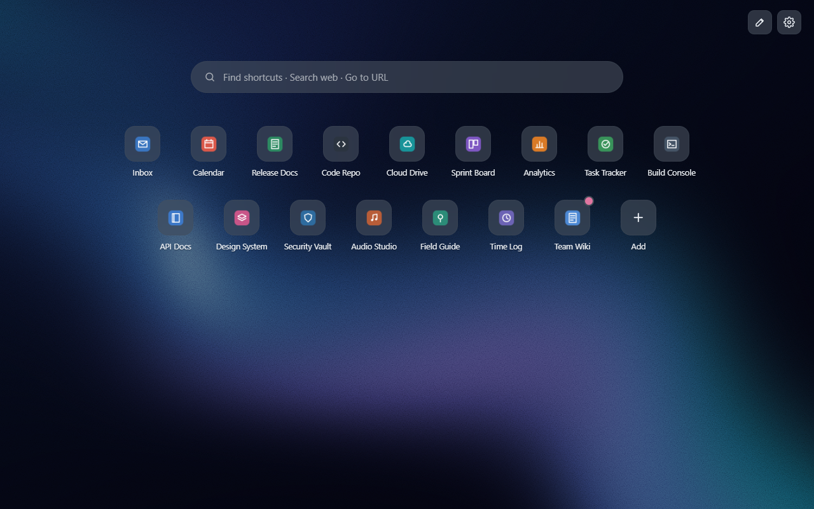
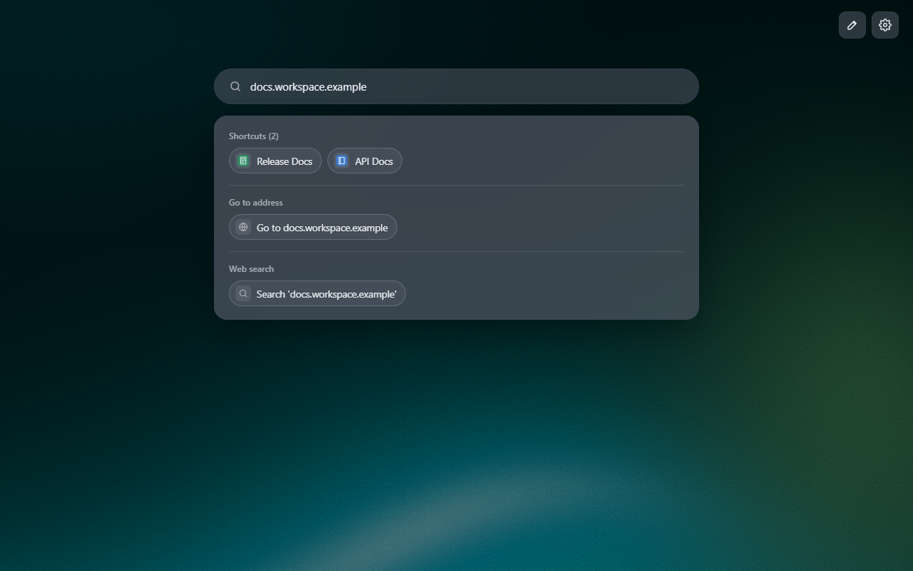
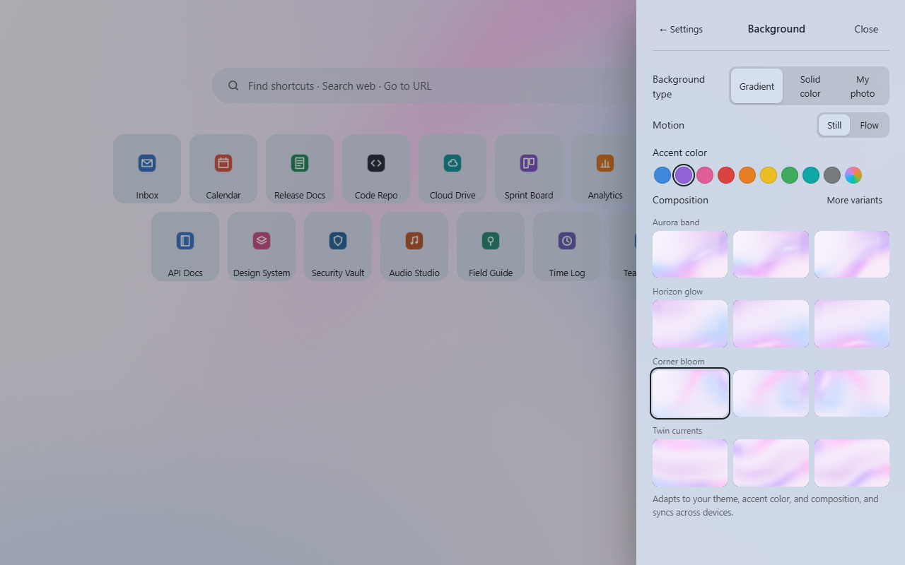
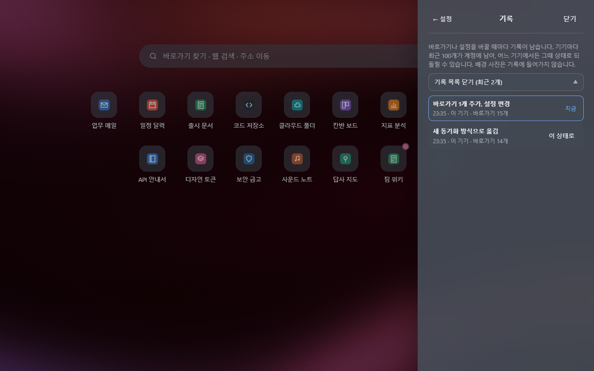

<div align="center">


# Tileshelf

**An unlimited shortcut shelf for Chrome's New Tab—synced through your Google account with zero sign-up.**

Sync shortcuts, custom icons, and appearance across devices via Chrome Sync,<br/>
roll back with 100-step per-device version history, search everything from one bar, and back up photos in a single `.json` file.

[한국어](README.md) · [**English**](README.en.md) · [**Download Latest Release (ZIP)**](https://github.com/Argoneon1810/Tileshelf/releases/latest) · [Chrome Web Store](https://chromewebstore.google.com/detail/tileshelf/gpcpfkhbghjbcoechkpdfcjokolhfnep) · [Changelog](CHANGELOG.md) · [Privacy Policy](PRIVACY.md) · [Report an Issue](https://github.com/Argoneon1810/Tileshelf/issues)

</div>

---



## Why Tileshelf?

- **No 10-shortcut ceiling** — Add as many tiles as you need, drag to reorder, attach custom icon images, or save local `file://` paths alongside web links.
- **Zero-account cross-device sync** — Shortcuts, custom icons, and display settings sync automatically across devices signed into the same Google account with Chrome Sync enabled—no third-party cloud login or developer server.
- **100-step version history & safe conflict recovery** — Every edit records a compact delta checkpoint per device. Open **Settings → History** anytime to inspect device timelines and restore an earlier state.
- **Single-file backup (`.json`) including your wallpaper** — Export and import shortcuts, custom icons, appearance settings, and your local background photo together in one portable file.

---

## Installation

Choose the installation method that fits your workflow:

- **Chrome Web Store (Recommended)**: Best for one-click installation and automatic updates. New versions arrive after store review completes, which may be later than GitHub Releases.
- **GitHub Release ZIP**: Best if you want the latest version immediately upon release without needing build tools or Node.js. Updates must be applied manually.

> **Switching between installation methods**: Chrome treats the Web Store version and the ZIP version as separate extensions. Before switching, export your data as a `.json` file from **Settings → Backup → Export backup file** in your current version, then restore it via **Import backup file** in the newly installed one.

### 1. Install from Chrome Web Store
1. Open the [Tileshelf page on the Chrome Web Store](https://chromewebstore.google.com/detail/tileshelf/gpcpfkhbghjbcoechkpdfcjokolhfnep).
2. Click to install. Updates will be applied automatically after store review.

### 2. Install from GitHub Release ZIP
1. Download `tileshelf-<version>.zip` from the [Latest Release page](https://github.com/Argoneon1810/Tileshelf/releases/latest) and extract it to a permanent folder you won't delete (e.g., `Documents/Tileshelf`).
2. Open `chrome://extensions` in your Chrome address bar and turn on **Developer mode** at the top right.
3. Click **Load unpacked** at the top left and select the extracted folder (the folder directly containing `manifest.json`).
4. When you open a new tab and Chrome asks whether to keep the new tab page changes, click **Keep it**.

- **How to update**: The ZIP version does not update automatically. Download the new `tileshelf-<version>.zip`, **extract and overwrite it into the exact same folder you used for the initial installation**, and click the reload (circular arrow) button on the Tileshelf card in `chrome://extensions`. Extracting into a different folder causes Chrome to treat it as a separate extension with empty shortcuts and settings (your original data remains tied to the previous folder's extension).

<details>
<summary><strong>3. Build from Source (For Developers)</strong></summary>

Requires `Node.js 24+` (unit tests import TypeScript modules directly).

```bash
git clone https://github.com/Argoneon1810/Tileshelf.git
cd Tileshelf
npm install
npm run build
```

Then open `chrome://extensions`, enable **Developer mode**, click **Load unpacked**, and select **`dist`** (never the repository root).

</details>

---

## Feature Walkthrough

### 1. Unified Search Bar — Shortcuts, Direct URLs & Web Search



- Typing in the search bar replaces the grid with grouped result chips: **Shortcuts**, **Go to address**, and **Web search**.
- Press `Enter` in the input to focus the first chip, navigate across chips with arrow keys, and press `Enter` again to open (IME composition confirmation `Enter` in Korean, Japanese, and Chinese is guarded so focus never jumps mid-word).
- Reorder group priority via drag or Up/Down arrow keys in **Settings → Display → Search result order**. Pressing `Enter` twice in the search bar runs the `#1` group right away.
- Web search delegates directly to your Chrome default search engine via `chrome.search.query` without altering browser search settings.

### 2. Calm Backgrounds & Measured `5:1+` Label Legibility

| Light Theme & Background Drawer | Korean Dark Theme & 100-Step History |
| :---: | :---: |
|  |  |

- **Gradients, Solid Colors & Local Photos**: WebGL mesh gradients (`src/ts/aurora.ts`) combine 9 accent palettes (plus custom color picker) × 4 compositions (`Aurora band`, `Horizon glow`, `Corner bloom`, `Twin currents`) × gentle motion or still frames, carving out a calm zone behind the search bar and shortcut grid.
- **Measured `5:1` Contrast Modes**: Choose **Dim overlay** (`57%` default), **Frosted card**, or **Text shadow** under **Settings → Label Legibility**. Minimum contrast ratios measured across all 9 accents × 4 compositions and two test photos (bright lake / dark ribbon) against the `5:1` target:

| Legibility Style | Dark Gradient | Light Gradient | Photos (Bright Lake / Dark Ribbon) |
| --- | --- | --- | --- |
| **Frosted card** | `11.67` | `14.07` | `9.74` / `11.58` |
| **Dim overlay (`57%`, default)** | `6.32` | `10.4+` | `5.15` / `7.18` |
| **Dim overlay (`24%`)** | `3.79` | `11.24` | `1.81` / `3.35` |
| **Text shadow** | `2.31` | `10.31` | `1.05` / `2.07` |

### 3. Chrome Account Sync vs. Single-File Backup

| Item | Google Account Sync (`chrome.storage.sync`) | Backup File (`.json`) |
| --- | --- | --- |
| Shortcuts (name, URL, order) | Yes | Yes |
| Custom shortcut icons | Yes (omitted first if account exceeds `100 KB` quota) | Yes |
| Theme, tile size, legibility, search order & gradient settings | Yes | Yes |
| Local background photo | No (`100 KB` Chrome Sync quota; other devices show gradient) | Yes |
| Per-device Sync On/Off toggle | Independent per device | Not transferred |

### 4. 100-Step Checkpoint Sync & Empty-State Protection

1. Rapid edits coalesce into compact checkpoints. Each device writes up to 100 delta-compressed checkpoints into its own storage key, preventing simultaneous edits on two machines from clobbering each other's history.
2. **Fresh-install protection**: A newly installed device never overwrites an existing account with `0` shortcuts. If shortcuts are added offline before sync arrives, they form a separate branch rather than silently overwriting other devices, and can be selected anytime in **Settings → History**.
3. **Automatic reseed & pre-restore safety**: If Chrome Sync data is cleared (for instance after uninstalling on one machine), another synced device automatically reseeds the account from its local pack. Rolling back to an older checkpoint also snapshots any pending unsaved edits first so you can undo the rollback.

### 5. Shortcut Editing & Tile Display
- **Quick Shortcut Editing**: Hover over a tile and click the pencil button at the bottom-right of the icon, or right-click the tile to open the edit dialog (name, URL, and icon).
- **Edit Mode**: Toggle edit mode using the pencil button (**Edit shortcuts**) next to the settings button at the top right. When active, all shortcuts show a pencil button and a dashed border, and clicking any tile opens the edit dialog instead of visiting the site. Click the button again or press `Esc` to exit.
- **Keyboard Navigation**: Pressing `Tab` stops once on each shortcut. To edit with a keyboard, turn on **Edit shortcuts** and press `Enter`, or press the context menu key (`Shift+F10`) on a focused tile.
- **New Shortcut Indicator**: Shortcuts added within the last 24 hours display a small dot at the top right; hover over it to see what it means.
- **Hiding Names & Hover Labels**: Turning off **Settings → Label legibility → Always show shortcut names** hides the labels and expands the icon panels accordingly. Turning on **Show name on hover** reveals the name only on the tile you are hovering over.

### 6. Icon Cleanup & Surface Tone Balance
- **Icon Display Area Scale**: Adjust how much space the icon takes up inside its panel from 35% to 75% (50% by default) under **Settings → Display → Icon display area scale**.
- **Surface Tone Balance**: Use the single slider at **Settings → Display → Surface tone balance** to adjust the brightness of all panels across the app at once (icon backing panels, search bar, buttons, settings drawer, dialogs, and toasts). Moving toward the left end (**Clear text**) makes text on panels easiest to read, while moving toward the right end (**Vivid icons**) makes transparent logos (black logos in Dark theme, white logos in Light theme) stand out best at the cost of making muted description text harder to read (centered by default).
- **Icon Background & Margin Cleanup**: Open **Settings → Display → Icon background & margin cleanup → Inspect & configure…** to remove solid outer backgrounds, crop transparent margins, normalize sizes, and adjust contrast for Dark theme—either in batch or per icon. This only applies to custom image icons chosen in the edit dialog (not automatically fetched site icons) and leaves the original images untouched, calculating and applying the cleanup only when drawing a new tab.
- **Flatten into Originals for Speed**: To open new tabs faster on slower computers, **Flatten into originals for speed…** overwrites the original images with the currently displayed cleanup results. This action is permanent—original images, removed backgrounds, and cropped margins cannot be recovered, and contrast adjustments lock to the current theme's colors—and can only be canceled via the **Undo** button on the toast notification shown immediately after execution.

---

## Good to Know & Safety Notices

- **Periodic Backups & Plain-Text `.json` Privacy**: Export backup files periodically via **Settings → Backup** to keep an extra copy of important shortcuts. Backup (`.json`) files store shortcut URLs and background photos in unencrypted plain text—keep them private on shared computers and before sharing files externally.
- **Screen Sharing Awareness**: Opening a new tab displays your shortcut titles and URLs on screen. Check your visible tiles before sharing your screen in meetings or streams.
- **Local File (`file://`) Shortcuts**: Tileshelf intentionally requests zero broad `file:///*` host permissions. Clicking a `file://` tile attempts tab navigation via `chrome.tabs` and, if blocked by Chrome's security policy, offers a one-click **`Copy URL`** toast so you can paste the path into the address bar.
- **Chrome 138+ New Tab Footer Bar**: Starting in Chrome 138, Chrome appends a bottom attribution bar whenever an extension overrides the New Tab page. Right-click that footer or turn off **Show footer on New Tab page** in Customize Chrome to hide it.

---

## Privacy & Permissions

The developer operates **no servers** and collects **zero user data**. Full details are documented in [PRIVACY.md](PRIVACY.md).

| Permission | Why It Is Needed |
| --- | --- |
| `storage` | Stores shortcuts, custom icons, appearance settings, and 100-step checkpoint history in `chrome.storage.local`, and syncs them across devices on the same Google account via `chrome.storage.sync`. |
| `unlimitedStorage` | Stores user-selected local background photos and custom icon images in `chrome.storage.local` without hitting Chrome's default `10 MB` local quota. |
| `favicon` | Renders shortcut icons from Chrome's local `_favicon` cache for intranet/local addresses or whenever a network icon is unavailable. |
| `search` | Executes web searches from the search bar through your configured Chrome default search engine via `chrome.search.query` without changing search settings. |

> **Favicon Lookup Note**: For public `http`/`https` shortcuts without a custom image, Tileshelf requests the shortcut's domain name (never full paths or query strings) from `https://www.google.com/s2/favicons` (debounced by `350ms` while editing). `file://` paths, `localhost`, raw IP addresses, single-label intranet hosts, and reserved suffixes (`.local`, `.internal`, `.lan`, `.corp`, `.example`, etc.) are never queried externally.

---

## Development & Verification

Written in zero-runtime-dependency TypeScript (`src/ts/`). [scripts/build.mjs](scripts/build.mjs) and [scripts/check-dist.mjs](scripts/check-dist.mjs) verify that every reference inside `dist/` resolves strictly inside `dist/`.

```bash
npm run typecheck                     # TypeScript static analysis (tsc --noEmit)
npm test                              # Unit tests covering sync, delta packs, backup, search, i18n & security (Node.js 24+)
npm run build                         # Compile src → dist and verify zero external references
npm run package                       # Build Chrome Web Store / GitHub Release archive at release/tileshelf-<version>.zip
node scripts/generate-release-notes.mjs  # Generate bilingual release notes + SHA-256 checksum
python scripts/generate-icons.py      # Regenerate store-compliant extension icons (16/32/48/128px)
node scripts/generate-store-assets.mjs   # Capture 4 store screenshots + 440x280 promo tile via headless Chrome
```

---

## Documentation & License

- **License**: [GNU General Public License v3.0 or later (`GPL-3.0-or-later`)](LICENSE) — provided free `"AS IS"` without warranty of any kind; to the extent permitted by law, the author is not liable for data loss or damages arising from use.
- **Third-Party Notices**: [THIRD_PARTY_NOTICES.md](THIRD_PARTY_NOTICES.md) (`0` third-party runtime libraries in the shipped bundle)
- **Privacy Policy**: [PRIVACY.md](PRIVACY.md)
- **Legal & Store Risk Mitigations**: [docs/store/legal-dispute-risks-and-mitigations.md](docs/store/legal-dispute-risks-and-mitigations.md)
- **Changelog**: [CHANGELOG.md](CHANGELOG.md)

<sub>Google and Chrome are trademarks of Google LLC. Tileshelf is an independent project and is not affiliated with, endorsed by, or sponsored by Google LLC.</sub>
