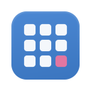
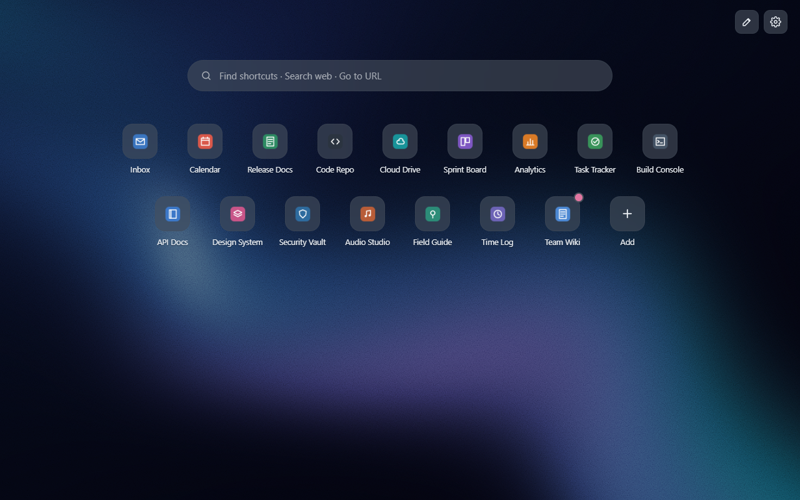
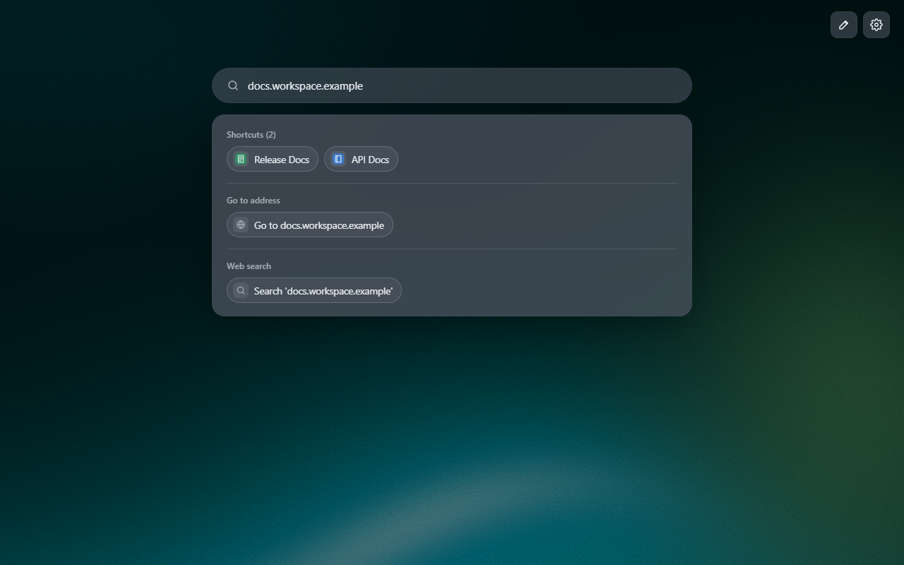
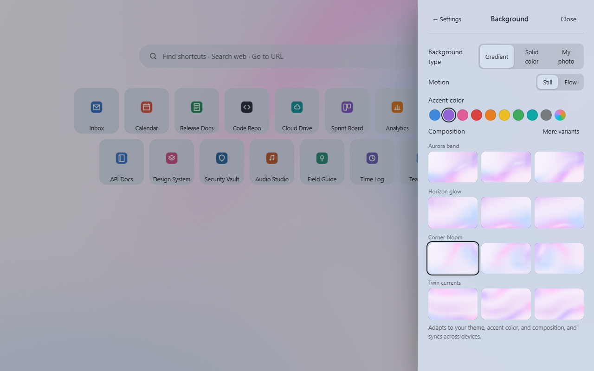
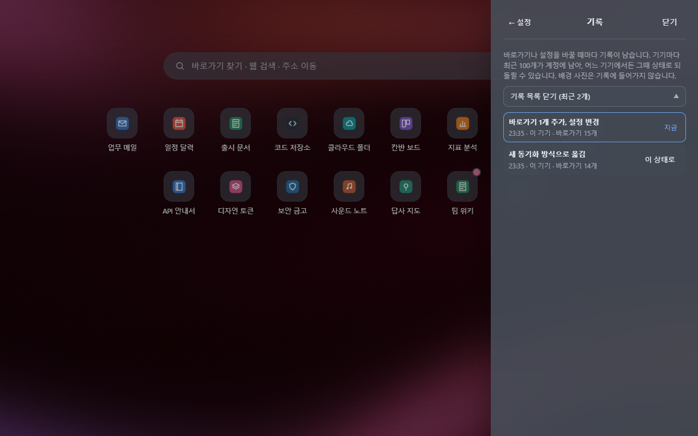

<div align="center">



# Tileshelf

**개수 제한 없이 채우고 Google 계정으로 바로 맞추는 Chrome 새 탭 바로가기 선반.**

별도 서비스 가입이나 외부 서버 없이 바로가기·아이콘·화면 설정을 기기 간 자동 동기화하고,<br/>
기기별 100단계 변경 기록과 배경 사진 단일 파일(`.json`) 백업, 통합 검색창을 한 화면에 담았습니다.

[**한국어**](README.md) · [English](README.en.md) · [**최신 릴리스 받기 (ZIP)**](https://github.com/Argoneon1810/Tileshelf/releases/latest) · [Chrome 웹 스토어](https://chromewebstore.google.com/detail/tileshelf/gpcpfkhbghjbcoechkpdfcjokolhfnep) · [바뀐 내역](CHANGELOG.md) · [개인정보처리방침](PRIVACY.md) · [버그 제보](https://github.com/Argoneon1810/Tileshelf/issues)

</div>

---



## 이럴 때 씁니다

- **Chrome 기본 새 탭의 바로가기 10개 한도가 답답할 때** — 원하는 만큼 타일을 더하고 끌어 순서를 바꿉니다. 사이트 기본 아이콘 대신 직접 고른 이미지를 넣거나 로컬 파일(`file://`) 경로를 등록할 수도 있습니다.
- **별도 클라우드 계정을 만들지 않고 여러 PC에서 같은 새 탭을 쓰고 싶을 때** — Chrome 동기화를 켠 같은 Google 계정 기기끼리 바로가기와 화면 설정이 자동으로 맞춰집니다.
- **실수로 지우거나 다른 기기 설정에 덮였을 때 되돌리고 싶을 때** — 바꿀 때마다 기기별로 최근 100개까지 가벼운 변경 기록(체크포인트)이 남아 어느 시점으로든 바로 복원합니다.
- **배경 사진까지 통째로 보관하거나 다른 브라우저 프로필로 옮길 때** — 바로가기, 직접 넣은 아이콘, 화면 설정, 내 사진 배경을 `.json` 파일 하나로 내보내고 불러옵니다.

---

## 설치하기

사용 환경에 맞는 설치 방법을 골라 주세요.

- **Chrome 웹 스토어 (권장)**: 단추 한 번으로 간편하게 설치하고 자동으로 업데이트를 받고 싶을 때 알맞습니다. 다만 새 판은 스토어 심사가 끝난 뒤에 도착하므로 GitHub 릴리스보다 늦을 수 있습니다.
- **GitHub 릴리스 ZIP**: 빌드 도구나 Node.js 없이 새 판이 나오자마자 곧바로 받아 쓰고 싶을 때 알맞습니다. 업데이트는 직접 덮어써야 합니다.

> **두 설치 방법 사이를 옮길 때**: Chrome은 웹 스토어 판과 ZIP 판을 서로 다른 확장으로 취급합니다. 다른 방법으로 갈아타기 전에 먼저 쓰던 쪽에서 **설정 → 백업 → 백업 파일 내보내기**로 `.json` 파일을 저장한 뒤, 새로 설치한 쪽에서 **백업 파일 불러오기**로 데이터를 옮겨 주세요.

### 1. Chrome 웹 스토어에서 설치
1. [Chrome 웹 스토어의 Tileshelf 페이지](https://chromewebstore.google.com/detail/tileshelf/gpcpfkhbghjbcoechkpdfcjokolhfnep)를 엽니다.
2. 설치 단추를 누르면 바로 설치되며, 이후 새 판이 나오면 자동으로 업데이트됩니다.

### 2. GitHub 릴리스 ZIP으로 설치
1. [최신 릴리스 페이지](https://github.com/Argoneon1810/Tileshelf/releases/latest)에서 `tileshelf-<버전>.zip` 파일을 내려받아 앞으로 지우지 않을 폴더(예: `문서\Tileshelf`)에 압축을 풉니다.
2. Chrome 주소창에 `chrome://extensions`를 입력해 열고, 오른쪽 위의 **개발자 모드**를 켭니다.
3. 왼쪽 위의 **압축해제된 확장 프로그램을 로드합니다**를 누르고, 방금 압축을 푼 폴더(`manifest.json`이 바로 들어 있는 폴더)를 고릅니다.
4. 새 탭을 열었을 때 Chrome이 새 탭 페이지 변경을 유지할지 물으면 **변경사항 유지**를 누릅니다.

- **업데이트 방법**: ZIP 판은 자동으로 업데이트되지 않습니다. 새 `tileshelf-<버전>.zip`을 받아 **반드시 처음 설치할 때 압축을 풀었던 것과 같은 폴더에 덮어 풀고**, `chrome://extensions`의 Tileshelf 카드에서 새로고침(동그란 화살표) 단추를 누릅니다. 다른 폴더에 압축을 풀어 불러오면 Chrome이 다른 확장으로 취급하여 바로가기와 설정이 비어 보입니다(원래 데이터는 이전 폴더의 확장에 남아 있습니다).

<details>
<summary><strong>3. 소스 코드에서 직접 빌드해 넣기 (개발자용)</strong></summary>

단위 시험이 TypeScript 원본을 직접 실행하므로 `Node.js 24` 이상이 필요합니다.

```bash
git clone https://github.com/Argoneon1810/Tileshelf.git
cd Tileshelf
npm install
npm run build
```

빌드가 끝나면 `dist` 폴더가 생깁니다. `chrome://extensions`의 **압축해제된 확장 프로그램을 로드합니다**에서 저장소 루트가 아닌 **`dist`** 폴더를 선택하세요.

</details>

---

## 주요 기능

### 1. 통합 검색창 — 바로가기 찾기 · 주소 이동 · 웹 검색



- 검색창 하나에 입력하면 격자 자리에 **바로가기**, **주소로 이동**, **웹 검색** 결과 칩이 종류별 묶음으로 나옵니다.
- 입력칸에서 `Enter`를 누르면 첫 칩으로 초점이 옮겨지고 방향키로 칩 사이를 오간 뒤 다시 `Enter`를 누르면 실행됩니다(한국어·일본어·중국어 입력기 조합 확정 `Enter`에서는 초점이 성급하게 튀지 않도록 보호합니다).
- **설정 → 화면 설정 → 검색 결과 순서**에서 묶음 우선순위를 끌거나 방향키로 바꿀 수 있습니다. 맨 위에 둔 묶음은 검색창에서 `Enter`를 두 번 연속 누르면 바로 실행됩니다.
- 웹 검색은 브라우저 검색 설정을 건드리지 않고 사용자가 Chrome에 지정해 둔 기본 검색 엔진(`chrome.search.query`)을 그대로 씁니다.

### 2. 배경 구도와 실측 대비 `5:1` 이름 가독성

| 밝은 테마 배경 설정 서랍 | 한국어 어두운 테마 100단계 변경 기록 |
| :---: | :---: |
|  |  |

- **그라데이션 · 단색 · 내 사진 배경**: WebGL 메쉬 그라데이션(`src/ts/aurora.ts`)은 9가지 강조색(직접 색상 선택 포함) × 4가지 구도(`오로라 띠`, `지평선 빛`, `한쪽 빛무리`, `두 물결`) × 변형 씨앗으로 그려지며, 검색창과 바로가기 타일 뒤를 '조용한 구역'으로 비워 글자가 묻히지 않게 합니다.
- **실측 `5:1` 기준 이름 가독성**: **설정 → 이름 가독성**에서 `배경 막`(기본 `57%`), `반투명 카드`, `그림자 효과` 중 고릅니다. 아래는 그라데이션(강조색 9개 × 구도 4개)과 시험용 사진 2장(밝은 호수 / 어두운 리본) 위에서 바로가기 이름 글자의 최저 명암비를 실측한 값입니다(권장 기준 `5:1`).

| 가독성 방식 | 그라데이션 어두운 테마 | 그라데이션 밝은 테마 | 사진 (밝은 호수 / 어두운 리본) |
| --- | --- | --- | --- |
| **반투명 카드** | `11.67` | `14.07` | `9.74` / `11.58` |
| **배경 막 (`57%`, 기본)** | `6.32` | `10.4` 이상 | `5.15` / `7.18` |
| **배경 막 (`24%`)** | `3.79` | `11.24` | `1.81` / `3.35` |
| **그림자 효과** | `2.31` | `10.31` | `1.05` / `2.07` |

### 3. Google 계정 동기화와 단일 파일 백업 비교

| 항목 | Google 계정 동기화 (`chrome.storage.sync`) | 백업 파일 (`.json`) |
| --- | --- | --- |
| 바로가기 (이름 · 주소 · 순서) | 지원 | 지원 |
| 직접 넣은 아이콘 이미지 | 지원 (계정 `100KB` 한도 초과 시 아이콘 그림부터 제외) | 지원 |
| 테마 · 타일 크기 · 가독성 · 검색 순서 · 그라데이션 설정 | 지원 | 지원 |
| 내 사진 배경 원본 | 미지원 (`100KB` 용량 한도, 사진 없는 기기는 그라데이션 표시) | 지원 |
| 이 기기 동기화 켜기 / 끄기 | 기기마다 개별 유지 | 옮기지 않음 |

### 4. 기기별 100단계 변경 기록과 빈 상태 덮어쓰기 방지

1. 바로가기나 설정을 바꾸면 짧은 시간 안의 연속 편집을 묶어 체크포인트 하나를 만듭니다. 기기마다 첫 기준 상태와 이후 변경분(델타)만 압축해 최근 100개까지 자기 전용 키에 쌓으므로 두 기기가 동시에 써도 서로의 기록을 지우지 않습니다.
2. **새 기기 빈 상태 보호**: 새로 설치해 아직 맞춘 적 없는 기기는 계정이 비어 있으면 빈 목록(`0개`)을 올리지 않고 기다립니다. 계정 기록을 받기 전에 먼저 타일을 추가했다면 별도 계보로 분리해 기존 기기 목록을 저절로 덮지 않으며, **설정 → 기록**에서 원하는 계보를 직접 고를 수 있습니다.
3. **계정 기록 자동 복구**: 확장 재설치 등으로 계정 동기화 저장소가 비워지면 맞춘 적 있는 다른 기기가 로컬 기록으로 계정을 다시 채웁니다. 또한 예전 기록으로 되돌리기 직전에 아직 저장 대기 중이던 변경이 있으면 먼저 체크포인트로 남겨 유실을 막습니다.

### 5. 바로가기 편집과 타일 표시 방식
- **개별 바로가기 편집**: 마우스를 타일에 올리면 아이콘 오른쪽 아래에 뜨는 연필 단추를 누르거나, 타일을 마우스 오른쪽 단추로 누르면 편집 창(이름·주소·아이콘)이 열립니다.
- **바로가기 편집 모드**: 화면 오른쪽 위 설정 단추 옆의 연필 단추(**바로가기 편집 모드**)로 켜고 끕니다. 켜면 모든 바로가기에 연필 단추와 점선 테두리가 나타나며, 타일을 누르면 사이트 이동 대신 편집 창이 열립니다. 단추를 다시 누르거나 `Esc`를 눌러 끝냅니다.
- **키보드 조작**: `Tab`을 누르면 바로가기마다 한 번씩 멈춥니다. 키보드로 편집 창을 열려면 **바로가기 편집 모드**를 켜고 `Enter`를 누르거나, 원하는 타일에서 메뉴 키(`Shift+F10`)를 누릅니다.
- **새 바로가기 표시**: 새로 추가한 지 24시간 안의 바로가기에는 오른쪽 위에 작은 점이 붙으며, 마우스를 올리면 그 뜻이 나타납니다.
- **이름 숨김과 마우스 올림 표시**: **설정 → 이름 가독성 → 바로가기 이름 항상 표시**를 끄면 이름이 사라지고 그만큼 아이콘 판이 커집니다. **마우스를 올렸을 때 이름 표시**를 켜면 마우스를 올린 타일에만 이름이 뜹니다.

### 6. 아이콘 다듬기와 배경판 밝기 조절
- **아이콘 표시 영역 비율**: **설정 → 화면 설정 → 아이콘 표시 영역 비율**에서 판 안에서 아이콘이 차지하는 크기를 35%~75%(기본 50%) 사이로 조절합니다.
- **배경판 밝기 균형**: **설정 → 화면 설정 → 배경판 밝기 균형** 슬라이더 하나로 앱의 모든 판(아이콘 뒤 판, 검색창, 단추, 설정 서랍, 대화상자, 알림)의 밝기를 함께 바꿉니다. 왼쪽 끝(**글자 또렷이**)으로 갈수록 판 위 글자가 가장 잘 읽히고, 오른쪽 끝(**아이콘 선명히**)으로 갈수록 바탕 없는 로고(어두운 테마의 검은 로고, 밝은 테마의 흰 로고)가 가장 잘 보이는 대신 흐린 설명 글자가 읽기 어려워집니다(기본은 가운데).
- **아이콘 배경 · 여백 정리**: **설정 → 화면 설정 → 아이콘 배경 · 여백 정리 → 검사 및 설정…**에서 바깥 단색 배경 제거, 투명 여백 자르기, 크기 맞춤, 어두운 테마용 대비 보정을 여러 아이콘에 한꺼번에 적용하거나 하나씩 조절합니다. 편집 창에서 사용자가 직접 고른 이미지 아이콘에만 쓸 수 있으며(사이트에서 자동으로 가져온 아이콘에는 쓸 수 없음), 원래 이미지는 바꾸지 않고 새 탭을 열 때마다 계산해 화면에만 입힙니다.
- **원본에 덮어써서 속도 높이기**: 느린 컴퓨터에서 새 탭을 빨리 열기 위해, **원본에 덮어써서 속도 높이기…**로 지금 보이는 정리 결과를 원래 이미지에 덮어써 저장할 수 있습니다. 실행하면 원래 이미지와 지운 배경, 잘린 여백을 다시 꺼낼 수 없고 대비 보정도 그때의 테마 색으로 고정되어 되돌릴 수 없으며, 실행 직후 뜨는 알림의 **되돌리기**로만 취소할 수 있습니다.

---

## 알아 둘 점과 안전 안내

- **중요 바로가기 주기적 백업 및 평문(`.json`) 보관 주의**: 브라우저 동기화 초기화나 확장 삭제에 대비해 **설정 → 백업**에서 주기적으로 백업 파일을 내보내 보관하세요. 내보낸 `.json` 파일은 암호화되지 않은 일반 텍스트로 바로가기 주소와 배경 사진이 그대로 담기므로 외부 공유나 공용 기기 보관에 주의하세요.
- **화면 공유 전 확인**: 새 탭을 열면 등록해 둔 바로가기 이름과 주소가 격자와 검색 결과에 바로 나타납니다. 화상회의 등에서 전체 화면이나 브라우저 창을 공유하기 전에 노출을 원치 않는 주소가 없는지 확인하세요.
- **로컬 파일(`file://`) 바로가기 열기**: `Tileshelf`는 로컬 파일 전체 읽기 권한(`file:///*`)을 요구하지 않습니다. `D:\문서\안내.pdf`나 `file:///...` 주소를 타일로 저장해 눌렀을 때 Chrome 보안 정책이 직접 이동을 막으면, 원클릭 **`주소 복사`** 버튼이 달린 안내 알림을 띄워 주소창에 바로 붙여넣을 수 있게 돕습니다.
- **Chrome 138 이상 새 탭 하단 바닥글**: Chrome 138부터 확장이 새 탭을 대체하면 브라우저가 화면 맨 아래에 확장 이름과 `Chrome 맞춤설정` 막대를 표시합니다. 숨기려면 바닥글을 우클릭하거나 Chrome 맞춤설정에서 **새 탭 페이지에 바닥글 표시**를 끄세요.

---

## 개인정보 보호와 권한 안내

개발자는 별도 서버를 운영하지 않으며 어떠한 사용자 정보도 수집하거나 외부로 전송받지 않습니다. 자세한 내용은 [개인정보처리방침 (`PRIVACY.md`)](PRIVACY.md)에 적혀 있습니다.

| 권한 | 쓰는 이유 |
| --- | --- |
| `storage` | 바로가기, 직접 넣은 아이콘, 화면 설정, 100단계 변경 기록을 `chrome.storage.local`에 저장하고 같은 Google 계정 기기 간 동기화를 위해 `chrome.storage.sync`에 저장합니다. |
| `unlimitedStorage` | 사용자가 고른 고해상도 배경 사진과 커스텀 아이콘 이미지를 기본 로컬 저장소 한도(`10MB`)에 막히지 않고 기기에 보관합니다. |
| `favicon` | 사내망·로컬 주소이거나 네트워크에서 아이콘을 가져오지 못할 때 Chrome 내장 `_favicon` 캐시로 타일 아이콘을 표시합니다. |
| `search` | 검색창에 입력한 검색어를 브라우저 검색 설정 변경 없이 사용자의 기본 검색 엔진(`chrome.search.query`)으로 전달합니다. |

> **외부 아이콘 조회 안내**: 직접 이미지를 지정하지 않은 공개 웹(`http`/`https`) 바로가기는 아이콘 표시를 위해 도메인 이름(세부 경로·쿼리 제외)을 `https://www.google.com/s2/favicons`에 요청합니다. 편집 창 입력 중에는 `350ms` 디바운스를 거치며, `file://`, `localhost`, IP 주소, 단일 라벨 사내 호스트 및 예약 도메인(`.local`, `.internal`, `.lan`, `.corp`, `.example` 등)은 외부로 전송하지 않습니다.

---

## 개발 및 검증 명령어

런타임 외부 의존성(`0개`) 없이 순수 TypeScript(`src/ts/`)로 작성되어 있으며, 빌드 스크립트([scripts/build.mjs](scripts/build.mjs))와 참조 검사기([scripts/check-dist.mjs](scripts/check-dist.mjs))가 `dist/` 바깥을 가리키는 참조가 하나라도 있으면 빌드를 즉시 실패시킵니다.

```bash
npm run typecheck                     # TypeScript 정적 타입 검사 (tsc --noEmit)
npm test                              # 동기화·체크포인트·백업·검색·다국어·보안 단위 시험 (Node.js 24+)
npm run build                         # src → dist 컴파일 및 외부 참조 0건 검증
npm run package                       # 스토어·릴리스 배포용 release/tileshelf-<버전>.zip 생성
node scripts/generate-release-notes.mjs  # 릴리스 노트 및 SHA-256 체크섬 생성
python scripts/generate-icons.py      # 스토어 규격 확장 아이콘(16/32/48/128px) 재생성
node scripts/generate-store-assets.mjs   # 헤드리스 Chrome 기반 스토어 스크린샷 4종·프로모션 타일 촬영
```

---

## 문서 및 라이선스

- **라이선스**: [GNU General Public License v3.0 or later (`GPL-3.0-or-later`)](LICENSE) — 보증 없이 '있는 그대로(`AS IS`)' 무상 제공되며, 데이터 유실이나 사용 중 발생한 손해에 대해 개발자는 법령이 허용하는 범위에서 책임을 지지 않습니다.
- **오픈소스 및 출처 고지**: [THIRD_PARTY_NOTICES.md](THIRD_PARTY_NOTICES.md) (배포 번들 내 제3자 런타임 라이브러리 `0건`)
- **개인정보처리방침**: [PRIVACY.md](PRIVACY.md)
- **스토어 법적 위험 점검 명세**: [docs/store/legal-dispute-risks-and-mitigations.md](docs/store/legal-dispute-risks-and-mitigations.md)
- **판별 바뀐 내역**: [CHANGELOG.md](CHANGELOG.md)

<sub>Google과 Chrome은 Google LLC의 상표입니다. Tileshelf는 독립 프로젝트이며 Google LLC와 제휴하거나 후원·보증을 받지 않았습니다.</sub>
